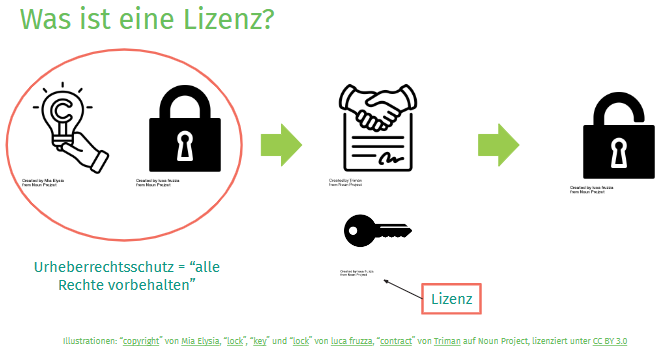
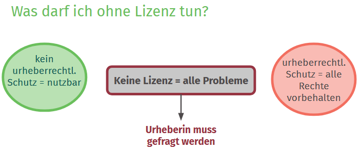
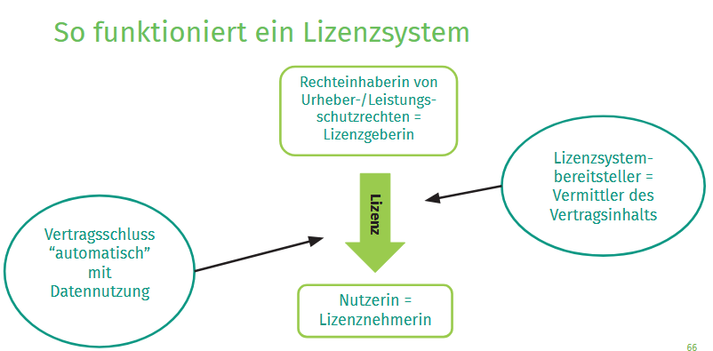
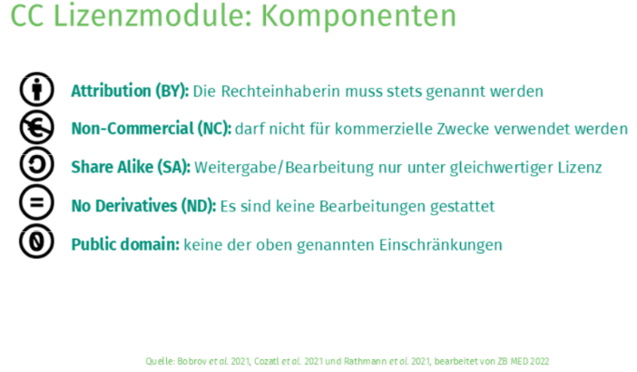

<!--

author:   Central Research Data Management of Kiel University, Linda Zollitsch
email:    zollitsch@ub.uni-kiel.de
version:  0.1.0
language: de
narrator: 

icon:     images\cau-norm-en-lilagrey-rgb.png

import:   https://raw.githubusercontent.com/LiaTemplates/Fullscreen/0.0.1/README.md

link: style_css.css

licence: CC-BY 4.0

comment:  Presentation Licences for PhDs

-->

# Lizenzen

-----

Lizenzen
---

> To see this document as an interactive LiaScript rendered version, click on the
> following link/badge:
>
> 
>
> If you have questions, please contact us: [Central Research Data Management](https://www.uni-kiel.de/de/universitaet/handlungsfelder/digitale-transformation/forschungsdatenmanagement)
>
> This work is licenced under CC-BY 4.0 (https://creativecommons.org/licenses/by/4.0/)

## Was ist eine Lizenz?

{{1}}
**********

Eine Lizenz ist ein vertraglich vereinbartes Nutzungsrecht.

- Sie ermöglicht die Nutzung eines geschützten Werks durch eine andere Person.

- Grundprinzip bei urheberrechtlich geschützten Werken:
  - Es gilt zunächst: Alle Rechte vorbehalten.
  - Ein Werk darf nicht einfach genutzt werden, wenn keine Erlaubnis vorliegt.
  - Die Nutzung muss mit der Rechteinhaber:in geklärt werden.

- Die Nutzungserlaubnis wird durch einen Vertrag vereinbart:
  -  Der Vertrag kann festlegen:
  
    -  Was genutzt werden darf.
    - In welchem Umfang die Nutzung erlaubt ist.
    -  Wie lange die Nutzung erlaubt ist.

  -  Der Vertrag muss nicht zwingend schriftlich abgeschlossen werden.

-  Die Lizenz ist der „Schlüssel“, der die Nutzung eines geschützten Werks ermöglicht.
  -  Sie erlaubt z. B. das Vervielfältigen, Herunterladen, Speichern oder Teilen eines Werks.

**********

## Was darf ich ohne Lizenz tun?

{{1}}
**********

Praxisbeispiel: Nutzung von Inhalten ohne Lizenzangabe

**Wenn ein Werk urheberrechtlich geschützt ist und keine Lizenzangabe vorhanden ist:**

- Es gilt grundsätzlich: Alle Rechte vorbehalten.
- Eine Nutzung ist nicht automatisch erlaubt.
- Die Rechteinhaber*in muss um Erlaubnis gefragt werden.

**Wenn ein Inhalt nicht urheberrechtlich geschützt ist:**

- Es wird keine Lizenz benötigt.
- Der Inhalt kann genutzt werden.
- Beispiel: Wetterdaten des DWD, die keinen urheberrechtlichen Schutz genießen.

**Problem in der Praxis:**

-  Wenn keine Lizenz oder Kennzeichnung vorhanden ist, ist oft unklar, ob ein Schutz besteht.
-  Es ist nicht immer direkt erkennbar, ob eine Nutzung erlaubt ist.

**********

## So funktioiniert ein Lizenzsystem

{{1-2}}
**********

**Individuelle Lizenzen vs. Lizenzsysteme**

- Eine Lizenz kann grundsätzlich individuell vereinbart werden.

  - Das bedeutet: Rechteinhaber*in und Nutzer*in legen die Bedingungen der Nutzung direkt fest.
  - Dies kann in der Praxis aufwendig sein.

**Lizenzsysteme vereinfachen diesen Prozess:**

- Die Rechteinhaber*in vergibt eine vorgefertigte Lizenz mit festgelegten Bedingungen.

**Funktionsweise eines Lizenzsystems:**

- Das Lizenzsystem vermittelt den Vertragsinhalt.
- Die Nutzer:innen müssen keine individuellen Vertragsbedingungen aushandeln.
- Der Nutzungsvertrag kommt automatisch durch die Nutzung des Werks zustande.
- Es gelten die Bedingungen der ausgewählten Lizenz.

**********

## Vor- und Nachteile von Lizenzsystemen

**Vorteile:**

-  Einfach und unkompliziert: Vorgefertigte Lizenzbedingungen müssen nicht individuell ausgehandelt werden.

- Schnelle Anwendung: Eine passende Lizenz kann direkt auf ein Werk bzw. Daten angewendet werden.

- Interoperabilität und Universalität: Bekannte Lizenzsysteme wie Creative Commons sind weit
verbreitet. Die Nutzung und Interpretation der Lizenzen ist dadurch einfacher und über verschiedene Kontexte hinweg möglich.

**Nachteile:**

- Möglicherweise fehlende Individualität: Vorgegebene Lizenzbedingungen müssen auf viele
verschiedene Werke und Daten anwendbar sein. Dadurch können sie möglicherweise nicht alle individuellen Nutzungsbedingungen oder besonderen Anforderungen eines Werks abbilden.

### Creative Commons

**Creative Commons (CC) als Lizenzsystem**

- Individuelle Lizenzverträge können in der Praxis aufwendig sein, da für jede Nutzung ein eigener Vertrag geschlossen werden müsste.
- Lizenzsysteme bieten deshalb standardisierte Lizenzverträge an.
- Die Creative-Commons-Lizenzen (CC-Lizenzen) ermöglichen eine einfache und standardisierte Regelung der Nachnutzung.

**Creative Commons Organisation**

- Creative Commons ist eine internationale Non-Profit-Organisation.
- Ziel ist es, die gemeinsame Nutzung von Bildung, Kultur und Wissenschaft im öffentlichen Interesse zu ermöglichen und zu erleichtern.
- Dafür stellt Creative Commons bei Bedarf:
  - technische,
  - rechtliche und
  - politische Lösungen bereit.

- Ein zentrales Angebot sind die vorgefertigten Creative-Commons-Lizenzen.

**Aufbau der CC-Lizenzen**

- Rechteinhaber:innen können mithilfe verschiedener standardisierter Lizenzmodule festlegen, wie ihr Werk genutzt werden darf.
- Dadurch müssen Nutzungsbedingungen nicht individuell für jede einzelne Nutzung ausgehandelt werden

### CC-Lizenzsystem

#### CC-BY

**CC BY (Attribution / Namensnennung)**

- Bekannteste Creative-Commons-Lizenz.
- Nutzung des Materials ist grundsätzlich kostenlos und frei möglich.
- Einzige Bedingung: Die Rechteinhaber:in muss genannt werden.
- Hinweis: Es wird bewusst von Rechteinhaber:in und nicht nur von Urheber:in gesprochen. 
- Creative-Commons-Lizenzen setzen nicht ausschließlich Werkschutz voraus, sondern können auch bei anderen urheberrechtlichen Leistungsschutzrechten relevant sein.

#### CC-SA

**CC-SA (Share-Alike)**

- Bearbeitungen dürfen weitergegeben werden, aber nur unter derselben bzw. einer gleichwertigen Lizenz.

#### CC-NC

**Non-Commercial in der Wissenschaft**

- Nutzung des Materials ist nur für nicht-kommerzielle Zwecke erlaubt.

- Wissenschaftliche Nutzung ist nicht automatisch nicht-kommerziell.
- Die Bewertung hängt vom konkreten Einzelfall ab.
- Mögliche Grenzfälle: 

  - Veröffentlichung eines Papers bei einem gewinnorientierten Verlag.
  - Auftragsforschung.
  - Zusammenarbeit mit kommerziellen Partnern.
  - Veröffentlichung auf einem privaten Wissenschaftsblog mit geschalteter Werbung.

### CC-Kombinationen

**Kombination von Creative-Commons-Modulen**

- Die verschiedenen Lizenzmodule können miteinander kombiniert werden.
- Dadurch entstehen unterschiedliche Creative-Commons-Lizenzvarianten mit verschiedenen Nutzungsbedingungen.
- Die genaue Bedeutung der einzelnen Kombinationen kann im Detail komplex sein.

**Bedeutung für Rechteinhaber:innen und Nutzer:innen**

- Eine Lizenz ist ein Vertrag, der festlegt, wie ein bestimmtes Werk genutzt werden darf.
- Rechteinhaber:innen können durch die Auswahl verschiedener Module bestimmen, welche Nutzungen sie erlauben möchten.
- Für Nutzer:innen ist die Lizenzkennzeichnung wichtig, um zu verstehen, welche Nutzungen eines fremden Werks erlaubt sind.

## Licence-Picker

https://creativecommons.org/chooser/ 

https://ufal.github.io/public-license-selector/

## Schöpfungshöhe
Zentrale Voraussetzung für den Werkschutz ist die Schöpfungshöhe bzw. die eigenpersönliche Prägung.

- Viele Daten scheitern an dieser Voraussetzung.
- Damit Daten Werkstatus erhalten, müssen sie ein Mindestmaß an Originalität aufweisen.

- Prüfung der Schöpfungshöhe:
   1. Gestaltungsspielraum:
  
  - Gibt es Raum, kreativ zu gestalten?
  - Oder bestehen nur strenge technische bzw. wissenschaftliche Vorgaben?
  - Beispiel: Ein Versuchsprotokoll mit fest vorgegebenen Arbeitsschritten bietet keinen ausreichenden kreativen Gestaltungsspielraum.

   2. Kreative Nutzung des Gestaltungsspielraums:
  - Der vorhandene Gestaltungsspielraum muss kreativ genutzt werden.
  - Eine rein technische oder wissenschaftlich vorgegebene Umsetzung reicht nicht aus.
  - Beispiel: Eine kreative Ausgestaltung über die rein echnischen oder wissenschaftlichen Vorgaben hinaus kann zu ausreichender Originalität führen.

-  Wird die Schöpfungshöhe (zusammen mit den weiteren Anforderungen) erreicht, besteht Werkschutz:
  -  Die schöpfende Person kann entscheiden, ob und wie andere Personen das Werk nutzen dürfen.
  - Sie kann die Rechte gerichtlich durchsetzen.

# Acknowledgement

Vielen Dank an Lea Sophie Singson und Sophie Boße von FAIRagro für die Bereitstellung ihres Workshops

Singson, L. S., & Boße, S. (2026, August 10). Die Lizenz zum Forschen: Wann gilt das Urheberrecht und was hat die Lizenz damit zu tun? - Don`t panic! Survival Guide on Law and Ethics in Research Episode III - Trainingmaterial. Zenodo. https://doi.org/10.5281/zenodo.21871110

## Thank you! :-)

Please take care of your data! 🌼
---
